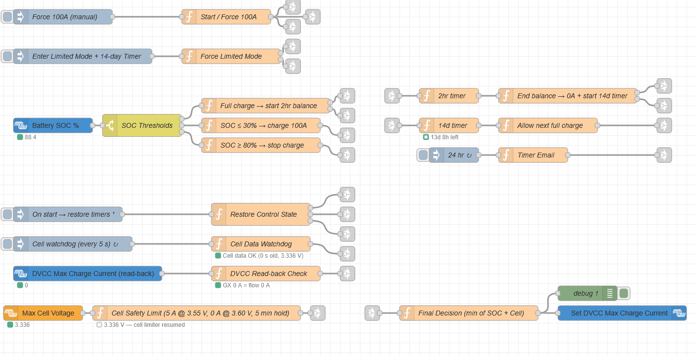

# Node-RED DVCC Control: Cell Protection and 30–80% SOC Cycling

This was HAND BUILT; however, I used AI to check for errors and clean up node descriptions. I tested the voltage limiter by using inject nodes to simulate a range of cell voltages. Next, I tested on a work bench with an actual pack in use. I then had Claude run the flow's actual code through a simulator: cell voltage sweeps from 3.40 V to 3.65 V, voltage spikes, bad and missing data, and a 50-day run with 30–80% cycles, several 14-day timer cycles and Node-RED restarts. It confirmed that the limiter and the timers work as described below.

Earlier versions of this flow have been running on my system since August 2026 without issues. This current version has been tested and running for 30 days (starting Oct 15 2026) with intentional over charging to test the cell protection and no issues were observed. A second instance has been running starting the same time with no outside influence without issues. 

## What it's for

Small solar systems where the battery sits at 100% all day. Keeping LiFePO4 at a high state of charge for long periods shortens its life, so this flow makes the battery actually use its capacity. Most of the time it cycles between 30% and 80%, with a full charge every two weeks so the cells can balance.

It also has a cell-voltage limiter that cuts charge current if any single cell runs high. This helps with packs whose cells drift apart, and adds another layer of over-voltage protection on top of the BMS.

## Requirements

- Cerbo GX, or a Raspberry Pi running Venus OS (Large image, with Node-RED)
- JK BMS through dbus-serialbattery (supplies the max cell voltage)
- A SmartShunt (supplies SOC)
- DVCC enabled
- node-red-contrib-victron
- Persistent context storage enabled in Node-RED's settings.js, so modes and timers survive a restart

## How the SOC cycle works

1. **Full charge:** charging is allowed up to 100%. When SOC reaches 99.8%, a 2-hour balance timer starts with charging still allowed (the cell limiter stays active).
2. **Limited mode:** after the 2 hours, DVCC is set to 0 A and a 14-day timer starts. The MPPT still powers loads, and in my system the battery may still gain around 2% SOC a day as 0 DVCC will still allow some current to the battery.
3. **30–80% window:** when SOC falls to 30%, charging is allowed up to 80%, then DVCC goes back to 0 A. This repeats for the rest of the 14 days.
4. **Back to 100:** When the 14 days are up, a full charge to 100% is allowed again and the cycle starts over.

Note that 30% is where charging starts, not a minimum. If it reaches 30% overnight, SOC will keep falling until the sun comes up.

## Cell voltage limiter

This watches the highest cell voltage and caps DVCC:

| Highest cell      | Charge current limit |
|-------------------|--------------------------------------|
| Below 3.550 V     | No limit (normal charging) |
| 3.550 – 3.599 V   | 5 A, tapering to 1 A (1 A per 10 mV) |
| 3.600 V and above | 0 A |

- **Reductions are immediate:** Any step down, including the cut to 0 A, is applied on the reading that triggers it.
- **Increases are slow:** Every step back up waits 5 minutes after the last change.
- **Release hold:** once the limiter has started, it holds 5 A and only releases after the highest cell has been below 3.550 V for 5 minutes. Any reading at or above 3.550 V restarts the 5 minutes.
- **Bad data:** a reading that isn't a number, or is below 2.0 V, forces 0 A.
- **Watchdog:** if cell readings stop for 60 s while the last reading was 3.40 V or higher, charging goes to 0 A until data returns.
- **Limited mode with the window closed:** the limiter is ignored while DVCC is already at 0 A, and resets once the cell drops to 3.380 V.

DVCC is set to whichever is lower, the SOC logic's value or the cell limiter's.

## Other features

- **Restart recovery:** after Node-RED restarts or redeploys, it restores the current mode and the time left on the 2-hour or 14-day timer, then rewrites DVCC.
- **DVCC read-back check:** if the setting on the GX doesn't match what the flow last wrote (a lost write, or a manual change), the flow writes it again. Rewrites are limited to once every 30 s.
- **Manual buttons:** *Force 100A* returns to normal charging, and *Enter Limited Mode* starts a fresh 14-day period.
- **Daily output of the 14-day time remaining:**, which I use for an email.

## Important

This is a software layer that only works while Node-RED is running. If Node-RED or the GX device stops, DVCC stays at whatever was last written. It also only controls chargers that follow DVCC. Keep the BMS's own over-voltage protection configured: it is the real last line of defense.

